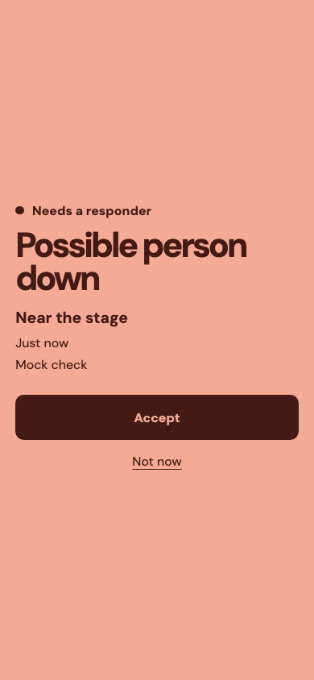
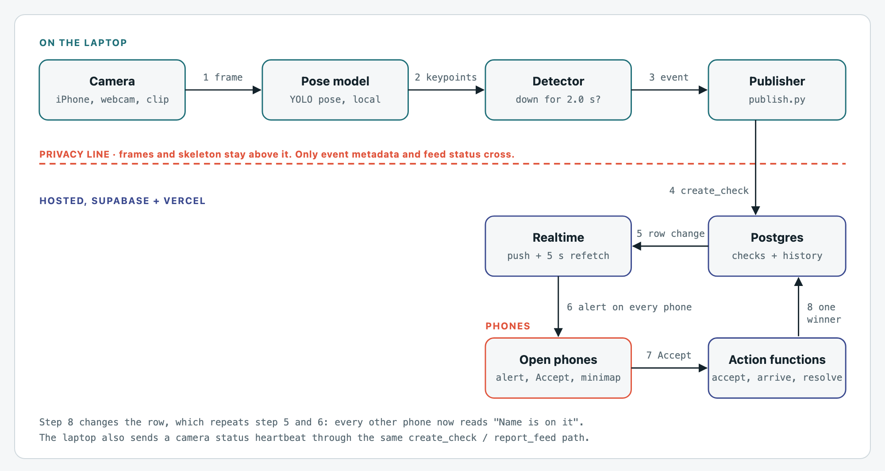
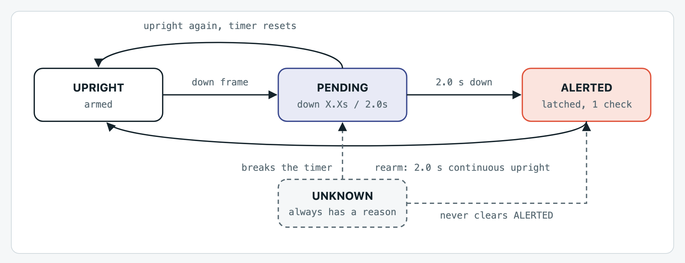
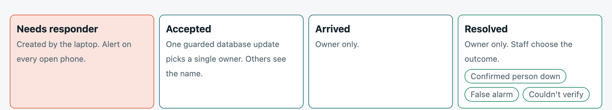

# Spotter

**A camera notices when someone may have collapsed, and tells the staff who can get there.**
Pose detection runs on a laptop, so video never leaves it. Staff phones get one alert, one person takes it, and everyone sees who is on the way.




https://github.com/user-attachments/assets/d4484a54-d3db-4ce9-9bf5-fe2b5412ae55


Built for McGill CodeJam 16. Live app: <https://codejam16-welfare-checks.vercel.app> (join with the room QR).

## Why this matters

In a large venue, the first problem is not treatment. It is that nobody has noticed, nobody knows who is going, and nobody knows exactly where the person is.

- **Minutes decide outcomes.** In one study of 3,723 witnessed cardiac arrests, each minute before the first shock lowered survival to discharge by about 6% ([Amsterdam UMC, 2024](https://pubmed.ncbi.nlm.nih.gov/39462804/)). In the US, survival was 15.6% when the arrest was witnessed and 4.6% when it was not ([CARES, 2023](https://mycares.net/sitepages/uploads/2024/2023%20National%20Non-Traumatic%20CARES%20Survival%20Report.pdf)). CPR started within two minutes was linked to 81% higher odds of surviving to discharge. After ten minutes the benefit was not detectable ([AHA, 2024](https://www.heart.org/en/news/2024/11/11/starting-bystander-cpr-within-10-minutes-of-cardiac-arrest-may-improve-survival)).
- **Crowds distract people, and finding someone who needs immediate attention is hard.** Event medical guidance targets basic life support within 4 minutes, and notes that locating a patient in a dark, loud, packed crowd is difficult ([Mass Gathering Medicine](https://www.cambridge.org/core/books/mass-gathering-medicine/mass-gathering-events-music-concerts-and-festivals/205AE87B4D2C692A9253F09B898DE94D), [NCBI](https://www.ncbi.nlm.nih.gov/books/NBK597369/)).
- **Handoffs fail.** At Astroworld 2021, a communication breakdown between the private medical contractor and the fire department [cost minutes](https://www.jems.com/ems-operations/as-astroworld-disaster-unfolded-houston-tx-fire-department-lost-contact-with-private-medic-group/).

Spotter targets the gap: **notice fast, say where, make ownership clear**. The same gap affects anyone who can collapse without warning, such as people with epilepsy, diabetes, POTS or heart conditions.

## What Spotter does

```text
perceive            decide                act                    human confirms
pose model   ->   down 2.0 s in the   ->   create one check   ->   Accept -> Arrived -> Resolved
on the laptop     floor region             on every open phone      Confirmed / False alarm / Couldn't verify
```

- A small pose model reads the camera locally. Bending, sitting and crouching do not alert. A sustained down posture does.
- Every open phone shows a full-screen alert with sound. One person taps **Accept**. Everyone else sees "Name is on it".
- Only that person can mark **Arrived** and record the outcome.
- If the camera is mapped, the alert shows a dot on a minimap of the floor.
- **Privacy:** frames and the skeleton overlay stay on the Mac. The hosted app receives event metadata and feed health only.
- **Compute:** no per-frame cloud calls. Network traffic is one small event per incident plus a feed heartbeat, instead of streaming frames to a vision-language model.

## System design



### Decisions

| Decision | Choice | Why, and what we rejected |
| --- | --- | --- |
| Where vision runs | Small local pose model (`yolo26n-pose`, fallback `yolo11n-pose`) | Video stays on the laptop and there is no per-frame cost. A cloud VLM on every frame is expensive and sends video off-site. |
| How "down" is decided | Explicit posture rule, held for 2.0 s | Explainable on screen (angle, timer bar) and tunable in `vision/config.py`. A trained classifier needs data we do not have. |
| Detector shape | Pure Python state machine, no cv2 or IO, driven by frame timestamps | Unit-testable on fake keypoints. Frame counts drift when frames drop. Only the latest frame is processed. |
| Not fooling itself | `UNKNOWN` always carries a reason and breaks pending timers. An alert latches until 2.0 s of clearly upright posture | Occlusion or a crowd must not create or clear an alert. Sitting up on the floor does not rearm. |
| Publisher boundary | `create_check(...)` and `report_feed(...)`, idempotent on `episode_id` | Vision does not know about the UI. A retried event creates one check. |
| Hosting | Supabase (Postgres, anonymous Auth, Realtime) + static app on Vercel | Phones on cellular cannot reach a laptop on venue Wi-Fi, and a QR printed in advance needs a fixed address. Rejected: a tunnel (address and Mac are single points of failure) and our own Flask host. The Flask/SQLite build stays on `feat/join-by-name` as the LAN fallback. |
| Joining | Room QR, a name, anonymous Auth. No roles or passwords | A stranger is on screen in seconds. |
| Authorization | Row-level security allows `select` for joined members only. All writes go through Postgres functions, and the actor comes from the session | The browser cannot forge an owner. Only the service role can create checks. |
| One winner | A single guarded `UPDATE ... WHERE status = 'needs_responder'` in `app_private.act()` | The database arbitrates simultaneous taps. A race test covers it. |
| Staying in sync | Realtime push plus a 5 s reconciliation fetch | A missed event cannot leave a stale button. |
| Location | Fixed camera, four calibrated floor points, homography to a minimap | A relative position is enough to know where to walk. Shown only when it lies inside the calibrated area. |

### Detector rule

A frame is **down** only if all of these hold, using COCO shoulders and hips at confidence 0.5 or higher:

- The shoulder-to-hip line is within 30° of horizontal.
- Its midpoints are inside the calibrated floor region.
- The keypoint bounding box is wider than tall.



Timers use frame timestamps, not frame counts. With several people, anyone down makes the frame down. Two or more confident people and nobody down makes it `UNKNOWN (multiple_people)`.

Each alert becomes one check with this lifecycle. Only the owner can mark arrival or resolve.



## Repo layout

| Path | What |
| --- | --- |
| `vision/` | Capture, pose, detector, calibration, location mapping, publisher, overlay runner, clip evaluation |
| `backend/supabase/` | Migrations, seed, database tests (Postgres, RLS, functions) |
| `frontend/` | Vite static app (alert, checks, presence, QR, minimap) and its tests |
| `tests/vision/` | Detector, capture, calibration, publisher tests. No camera or weights needed |
| `tools/` | `mock_check.py` (send a fake alert), kitchen calibration page |
| `fixtures/` | `person-down.json`, the shared event shape |
| `docs/` | [Runbook](docs/runbook.md), [design](docs/designs/live-venue-welfare-checks.md), [hosted design](docs/superpowers/specs/2026-11-21-supabase-live-alerts-design.md), [location design](docs/superpowers/specs/2026-11-22-kitchen-location-design.md), [rehearsal log](docs/hosted-rehearsal.md) |
| `local/`, `clips/` | Git-ignored: weights, calibration, recordings |

## Run it

Requires macOS, Python 3.12 (not 3.14, the model wheels lag) and Node 24. Docker and the Supabase CLI are needed only for path B.

### A. Detector only, no hardware

Use any short clip of a person lying down. `clips/` is git-ignored, so bring your own.

```bash
uv venv --python 3.12 .venv && uv pip install --python .venv/bin/python -r requirements.txt
.venv/bin/python vision/run.py --source clips/your_clip.mp4   # skeleton, torso angle, "down X.Xs / 2.0s" timer
.venv/bin/python -m pytest -q
```

Alerts print to stdout as JSON lines, and logs go to stderr. Weights download to `local/weights/` on first run.

### B. Full stack on your machine

```bash
cd backend && supabase start && supabase db reset && cd ..
cp frontend/.env.example frontend/.env.local   # set the local URL and the publishable key from `supabase status`
npm ci --prefix frontend && npm run dev --prefix frontend
```

Open `http://localhost:5173/?room=codejam-local` in two browser profiles and join with different names. Then, in another terminal with `SUPABASE_URL` and `SUPABASE_SECRET_KEY` set for the local project:

```bash
.venv/bin/python tools/mock_check.py
```

Both profiles show the alert. Tap **Accept** in both and only one wins. Run the checks with `npm test --prefix frontend`, `supabase test db` (from `backend/`) and `node backend/tests/race.mjs`.

### C. Live demo with a camera

1. Mount the iPhone (USB-C, locked) or use a webcam. Find its index: `.venv/bin/python vision/capture_probe.py --source 0 --frames 120`.
2. Calibrate the floor: `.venv/bin/python -u vision/run.py --source 0 --calibration-preview 5199`, then follow the printed editor URL.
3. Export the calibration to `local/kitchen-minimap-setup.json`, then run the publishing detector:

```bash
export SUPABASE_URL=...            # the hosted project URL
export SUPABASE_SECRET_KEY=...     # server key: keep it in your shell only, never commit it
.venv/bin/python -u vision/run.py --source 0 --camera-id kitchen-iphone --zone kitchen \
  --location-calibration local/kitchen-minimap-setup.json --publish
```

4. Scan the room QR on a phone, join, and keep **Checks** open. Lie down for 2 seconds, stand for 2 seconds, then do it again at a different spot.

| Flag | Use |
| --- | --- |
| `--source` | Camera index or video file |
| `--calibrate` | Click the floor polygon on the first frame |
| `--publish` | Send checks and feed status to Supabase |
| `--location-calibration` | Minimap calibration file |
| `--no-show`, `--device cpu`, `--save out.mp4` | Headless, force CPU, record the overlay |

**Troubleshooting.** Source `0` may be the Mac's own camera, so try `1`. Grant camera access in System Settings. If the feed stalls for 5 s, `run.py` exits with code 2. For USB fallback, calibration without the live editor, and provisioning your own Supabase and Vercel project, see the [runbook](docs/runbook.md).
