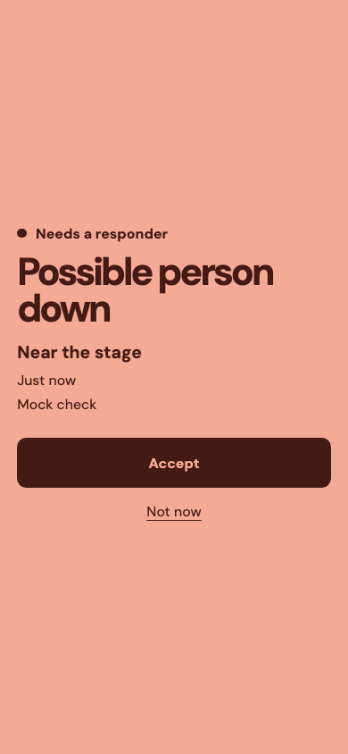

# Hosted welfare checks rehearsal

Production demo at [Vercel](https://codejam16-welfare-checks.vercel.app). The room QR is generated privately and opens the name-only join page.

| Check | Target | Result |
| --- | --- | --- |
| Database access, transitions and rollback | 46 SQL assertions | Passed on PostgreSQL 17 with Supabase Auth roles and a Realtime schema fixture |
| Simultaneous claims | 50 independent-session races, one owner and one claim history row each | 50/50 passed locally |
| Name-only QR join and presence | Join and see both people | Passed on two independent mobile-sized Chromium profiles against production. Wi-Fi and cellular phone rehearsal pending |
| Live alert | About one second from database creation | Both profiles displayed the alert about 0.13 s after creation in the final mock run. An earlier run showed about 0.50 s and 3.02 s. Physical-device sound and timing remain pending |
| Shared state | Dismiss locally, accept, refresh, rename, arrive, resolve and reconnect | Passed in both hosted profiles. Hosted replay of the same mock ID returned the existing check |
| Room access | No reads/actions without membership | Hosted API denied unauthenticated reads, unjoined actions and ingest, and wrong or missing room codes |
| Staged replay | Publish one check for one episode | Both existing takes emitted one detection each in local evaluation. The east-bar replay through the publisher created one hosted **Near the stage** check and one history row. The every-frame run processed at 46.2 fps with 16.1 ms/frame EMA inference. The rehearsal clips had no floor calibration |
| Calibrated live iPhone and audience rehearsal | No alert for ordinary movement, one for staged down, report FPS and latency | Pending the actual camera, venue network and phones |
| Feed loss | Labeled replay before a check or finish the existing check after losing the feed | Replay shutdown reported offline. Live camera loss still needs rehearsal |
| LAN fallback | Two independent responders, one winner, owner can refresh | 37 Flask store and workflow tests passed on the reference branch. Device rehearsal pending |

